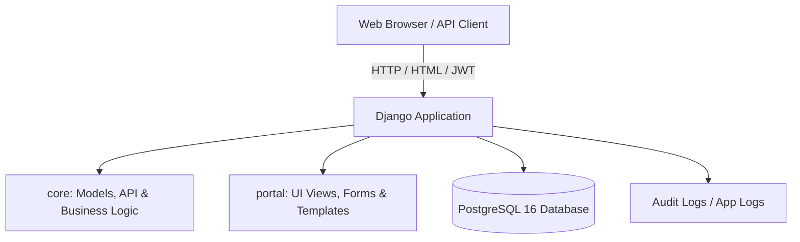
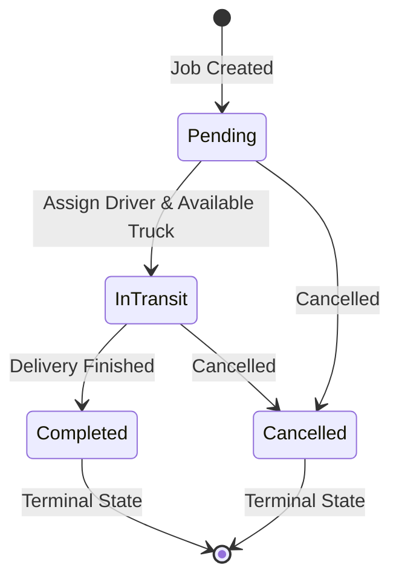

# Haulage Truck Management System — Architecture & How It Works

## 1. Overview

The **Haulage Truck Management System** is a full-stack logistics management application designed to track cargo delivery jobs, manage a fleet of haulage trucks, assign qualified drivers, and maintain a complete audit trail.

The application provides two primary interfaces:
1. **Web Portal:** A server-rendered UI (Django Templates) with role-based access control and admin approval workflows.
2. **REST API:** A token-authenticated API built with [Django Ninja](https://django-ninja.rest-framework.com/) with interactive OpenAPI documentation (`/api/docs`).

---

## 2. Architecture & Tech Stack



- **Backend:** Python / Django 6
- **API Framework:** Django Ninja (JWT Bearer Token Authentication)
- **Database:** PostgreSQL 16
- **Frontend:** Django Templates & Vanilla CSS
- **Containerization:** Docker & Docker Compose

---

## 3. Core Data Models

The data model is defined in [`core/models.py`](core/models.py):

| Model | Key Fields | Description & Rules |
| :--- | :--- | :--- |
| **`Truck`** | `registration_no`, `capacity`, `status` | Fleet vehicle. Status is either `available`, `in_transit`, or `maintenance`. Capacity measured in tonnes. |
| **`Driver`** | `name`, `license_no`, `phone_no` | Driver personnel. Unique alphanumeric license number and phone validation. |
| **`Job`** | `pick_up_location`, `delivery_location`, `cargo`, `status`, `assigned_truck`, `assigned_driver` | Cargo delivery order with strict lifecycle rules. Pick-up and delivery locations cannot be identical. |
| **`AuditLog`** | `timestamp`, `user`, `action` | Immutable event log tracking key actions across the system. |

---

## 4. How the System Works (Lifecycle & Business Rules)

### A. User Registration & Approvals
1. A new user registers via the web portal.
2. The account is created in an inactive state (`is_active = False`).
3. An administrator (superuser) must review and approve the user via `/users/pending/` before the user can log in.

### B. Job Progression & State Machine
Jobs move through a strictly validated state machine:



- **Pending:** The job is created without a vehicle or driver.
- **In Transit:** The job is actively assigned and en route.
- **Completed:** Cargo successfully delivered. Terminal state (cannot be altered).
- **Cancelled:** Job aborted. Terminal state (cannot be altered).

### C. Assignment Rules & Concurrency Control
When assigning a truck and driver to a job ([`portal/views.py`](portal/views.py)):
1. **Status Guard:** Only jobs in `pending` status can be assigned.
2. **Truck Availability:** The truck must currently be in `available` status. When assigned, its status changes to `in_transit`.
3. **Driver Availability:** The driver cannot have any active jobs (`pending` or `in_transit`).
4. **Concurrency Safety:** Assignments run inside database transactions (`transaction.atomic()`) with row-level locks (`select_for_update()`) to eliminate race conditions.
5. **Auto-Release:** When a job transitions to `completed` or `cancelled`, the assigned truck automatically reverts back to `available`.

### D. Audit Logging
Every critical action (user approval, truck creation, driver modification, job assignment, status change, and record deletion) writes an immutable record to the `AuditLog` table.
- Superusers can view all system logs.
- Standard users can only view their own action history.
- Only superusers are permitted to delete records.

---

## 5. System Interfaces

### Web Portal (`/portal/`)
- **Dashboard:** Fleet metrics, recent jobs, and active trucks.
- **Truck & Driver Management:** Create, update, list, and delete fleet resources.
- **Job Workflow:** Create delivery jobs, assign available resources, and update progress.
- **Audit Logs:** Activity logs viewer.

### REST API (`/api/`)
- **Auth:** `POST /api/auth/token` accepts username & password and returns a JWT bearer token.
- **Endpoints:**
  - `GET`, `POST` `/api/trucks/`
  - `GET`, `POST` `/api/drivers/`
  - `GET`, `POST` `/api/jobs/`
  - `POST` `/api/jobs/{id}/assign`
  - `POST` `/api/jobs/{id}/status`
- **Interactive Documentation:** Available at `/api/docs` (Swagger UI).

---

## 6. Project Directory Layout

```
haulage-truck-management/
├── core/                  # Domain models, Ninja REST API, JWT auth, unit tests
│   ├── models.py          # Truck, Driver, Job, AuditLog
│   ├── api.py             # Django Ninja REST API endpoints
│   ├── auth.py            # JWT token creation and Bearer auth handler
│   └── tests.py           # Unit and integration test suite
├── portal/                # Frontend application
│   ├── views.py           # Dashboard, CRUD views, assignment logic, user approvals
│   ├── forms.py           # Django forms with custom validation
│   └── templates/         # HTML templates for the portal
├── haulage/               # Django project settings and root routing
├── Dockerfile             # Container definition for web app
└── docker-compose.yml     # Multi-container orchestration (Django + PostgreSQL)
```
